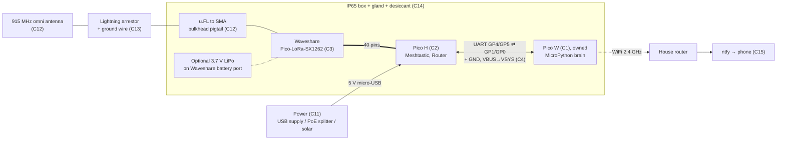
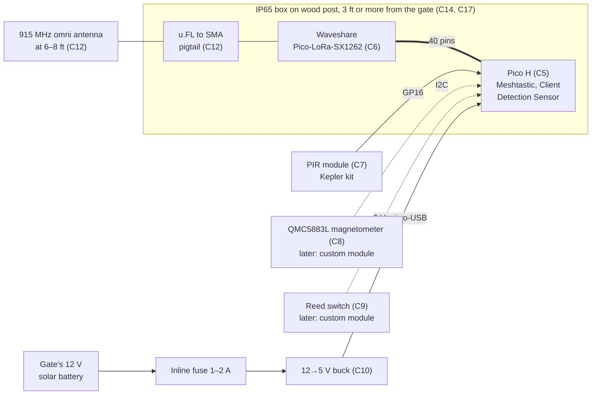
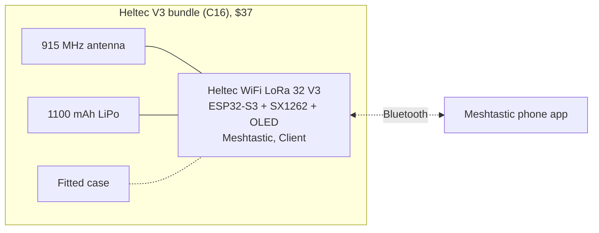
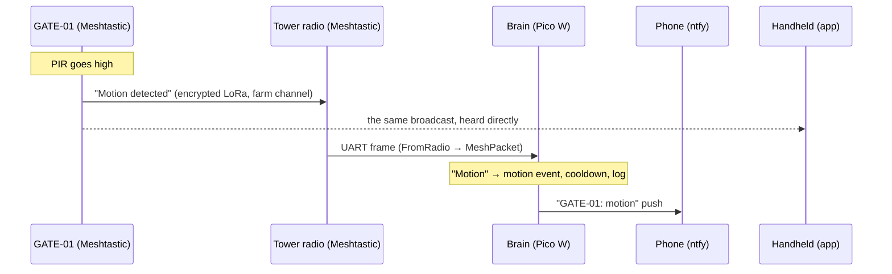

# Component design – Phase 1 (Meshtastic, DIY)

This file tracks every Phase 1 build: which assemblies there are, the parts in each, how each part connects, what runs on it, how to test it, and its status. When a part arrives, passes its test or changes, update its row here. Purchasing details are in [shopping-list.md](shopping-list.md), the build steps in [gateway-build-guide.md](gateway-build-guide.md), and the reasoning in [design.md](design.md).

**Every node has exactly one LoRa radio, and every radio runs stock Meshtastic.** Our own code runs only on the gateway brain (the Pico W).

## Assemblies

| Type | Assembly | Qty | Job | Runs |
| --- | --- | --- | --- | --- |
| 1 | **Gateway** (tower) | 1 | Tower radio hears and relays for the mesh. The brain logs events and pushes phone alerts over WiFi. | Radio: Meshtastic (Router, Serial PROTO). Brain: `firmware/gateway/` |
| 2 | **Gate PIR node** (GATE-01) | 1 | Reports motion at the gate | Meshtastic (Client, Detection Sensor). Later: a custom C++ module for vehicle and gate-open. |
| 3 | **Handheld** (TEST-01) | 1 | Range walks, test messages and watching the mesh, through the phone app | Meshtastic (Client) on a Heltec V3 |

These diagrams render on GitHub. In VS Code, install the "Markdown Preview Mermaid Support" extension.

### Type 1 – Gateway ×1

**Battery?** It isn't needed with mains or PoE. A small LiPo on the Waveshare board's battery port can carry the box through a short power cut. A battery is only required if the tower runs on solar (C11).

### Type 2 – Gate PIR node ×1

**Battery?** No. It runs from the gate's existing solar battery through the buck converter.

### Type 3 – Handheld ×1

**Battery?** Yes, it's included in the bundle and charges over USB-C.

### How a gate alert travels

**Does the gateway need to speak a custom protocol?** Only the brain does, and only for custom payloads. Stock messages (text, Detection Sensor) are plain Meshtastic. When the gate's custom C++ module arrives, it sends our 8-byte packet (`firmware/lib/packet.py`) on Meshtastic's `PRIVATE_APP` port. Relays and the tower radio forward and decrypt it without understanding it, and only the brain decodes the 8 bytes.

## Parts per assembly (rollup)

| Part | Gateway ×1 | Gate node ×1 | Handheld ×1 | **Total** | Have | **Buy** |
| --- | --- | --- | --- | --- | --- | --- |
| Waveshare Pico-LoRa-SX1262 (868M/915M) | 1 | 1 | — | **2** | 0 | **2** |
| Pico H (or WH) | 1 | 1 | — | **2** | 0 | **2** |
| Pico W | 1 | — | — | 1 | 1 (Kepler kit) | 0 |
| Heltec V3 bundle, 915 MHz | — | — | 1 | 1 | 0 | **1** |
| Female-female jumper wires | 4 | 3 | — | 7 | yes (kit) | 0 |
| PIR module | — | 1 | — | 1 | 1 (Kepler kit) | 0 |
| QMC5883L magnetometer (later) | — | 1 | — | 1 | 0 | later |
| Reed switch, outdoor (later) | — | 1 | — | 1 | bench only (kit) | later |
| 915 MHz outdoor antenna + u.FL-to-SMA pigtail | 1 | 1 | — | 2 | 0 | **2** |
| Lightning arrestor + ground wire | 1 | — | — | 1 | 0 | **1** |
| IP65 box + glands + desiccant | 1 | 1 | — | 2 | 0 | **2** |
| 12→5 V buck (micro-USB) + inline fuse | — | 1 | — | 1 | 0 | **1** |
| Tower power (C11) | 1 | — | — | 1 | ? | open |
| LiPo 3.7 V (optional) | 0–1 | — | — | 0–1 | 0 | optional |
| Wood post 4×4 + clamps | — | 1 | — | 1 | 0 | **1** |
| USB data cables | 2× micro-B | micro-B | USB-C | 4 | check | as needed |

## Parts detail

**Status values:** `owned` · `to order` · `ordered` · `received` · `bench tested` · `installed`

| ID | Part | Assembly | Interface / pins | Runs / code | Bring-up test (guide stage) | Status |
| --- | --- | --- | --- | --- | --- | --- |
| C1 | Raspberry Pi Pico W | Gateway brain | UART0 GP0 TX / GP1 RX; VSYS from C2 | MicroPython, `firmware/gateway/` | "Gateway online" alert (5); `radio session up` (9) | owned |
| C2 | Raspberry Pi Pico H | Gateway tower radio | UART1 GP4 TX / GP5 RX (Serial module); micro-USB 5 V | Meshtastic: Router, Serial PROTO 115200 | Web client connects (7) | to order |
| C3 | Waveshare Pico-LoRa-SX1262 (868M/915M) | Gateway, on C2 | SPI1 (pin map below) | — | Handheld sees TOWER (8) | to order |
| C4 | 4 jumper wires: GP4→GP1, GP5←GP0, GND, VBUS→VSYS | Gateway | — | — | `radio session up` (9) | owned (Kepler kit) |
| C5 | Raspberry Pi Pico H | Gate node | Micro-USB 5 V from C10 | Meshtastic: Client, Detection Sensor | Web client connects (11) | to order |
| C6 | Waveshare Pico-LoRa-SX1262 (868M/915M) | Gate node, on C5 | SPI1 (pin map below) | — | GATE-01 in the node list (11) | to order |
| C7 | PIR module, Kepler kit (HC-SR501 type, up to 7 m). Delay knob at minimum, jumper on L. | Gate node | OUT → GP16 (pin 21), VCC → VBUS (pin 40), GND | Detection Sensor: name "Motion", pin 16, logic high, 60 s | "GATE-01: motion" alert (11) | owned (Kepler kit) |
| C8 | QMC5883L (GY-271) magnetometer | Gate node (later) | I2C | Custom C++ module (logic in `firmware/legacy/gate/main.py`) | — | later |
| C9 | Reed switch, outdoor N.O. | Gate node (later) | GPIO | Custom C++ module | — | later |
| C10 | 12 V → 5 V buck converter, micro-USB, with a 1–2 A inline fuse | Gate node, from the gate's solar battery | 8–32 V in, 5 V micro-USB out | — | Multimeter reads 5.0 V before you plug in the Pico | to order |
| C11 | Tower power (USB supply, PoE splitter or solar) | Gateway | 5 V micro-USB into C2 | — | Gateway stays up for 24 h | open: tower power |
| C12 | 915 MHz omni antennas + u.FL-to-SMA pigtails (×2) | Gateway (tower top); gate node (post, 6–8 ft) | u.FL on C3 and C6 | — | Traceroute SNR from the gate spot (12) | to order |
| C13 | Lightning arrestor + ground wire | Gateway | SMA inline | — | Continuity to the tower ground | to order |
| C14 | IP65 enclosures, glands, desiccant (×2) | Gateway, gate node | — | — | No condensation after a week | to order |
| C15 | ntfy phone app and topic | Gateway output | HTTPS from C1 over the house WiFi | `gateway/main.py` (`push`), `secrets.py` | Test pushes (4) | to set up |
| C16 | Heltec V3 bundle, 915 MHz (board, 1100 mAh LiPo, case, antenna) | Handheld | Bluetooth to the phone | Meshtastic: Client | Message reaches TOWER (8) | to order |
| C17 | 4×4 treated wood post (8 ft) + clamps | Gate node | — | — | — | to order |

## Pin maps

**Waveshare LoRa board (C3, C6)**, used by Meshtastic: GP2 BUSY, GP3 CS, GP10/11/12 SPI SCK/MOSI/MISO, GP15 RESET, GP20 DIO1, GP26 battery sense.

| Board | Extra pins |
| --- | --- |
| Tower radio (C2) | GP4 = UART1 TX → brain, GP5 = UART1 RX ← brain, GND, VBUS (pin 40) → brain VSYS |
| Brain (C1) | GP0 = UART0 TX → radio GP5, GP1 = UART0 RX ← radio GP4, GND, VSYS (pin 39) ← radio VBUS |
| Gate node (C5) | GP16 = PIR (Detection Sensor). Later: I2C for the magnetometer, plus one GPIO for the reed switch. |

## Bring-up order

Follow [gateway-build-guide.md](gateway-build-guide.md):

1. **Brain alone (C1, C15):** stages 2–5.
2. **Tower radio (C2, C3):** stages 6–7, including the private "farm" channel.
3. **Handheld (C16):** stage 8.
4. **Brain + radio (C4):** stages 9–10, an end-to-end alert from a handheld message.
5. **Gate node (C5–C7):** stage 11, a PIR alert.
6. **Range and install (C10–C14, C17):** stages 12–14.

## Open items

- C11 tower power: mains, PoE or solar.
- C8/C9: the custom Meshtastic C++ gate module (vehicle and gate-open), which sends `packet.py` events on `PRIVATE_APP`.
- C9: check whether the gate controller already has a dry-contact gate-open output.
