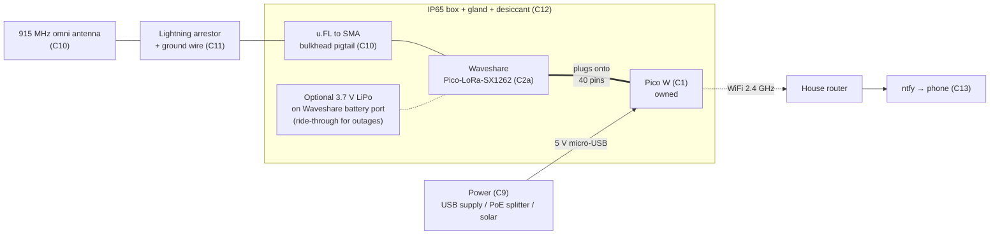
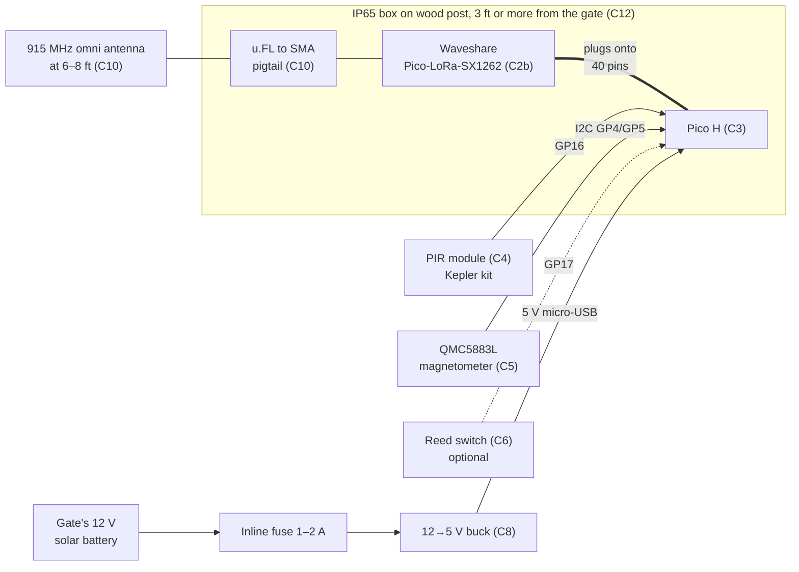
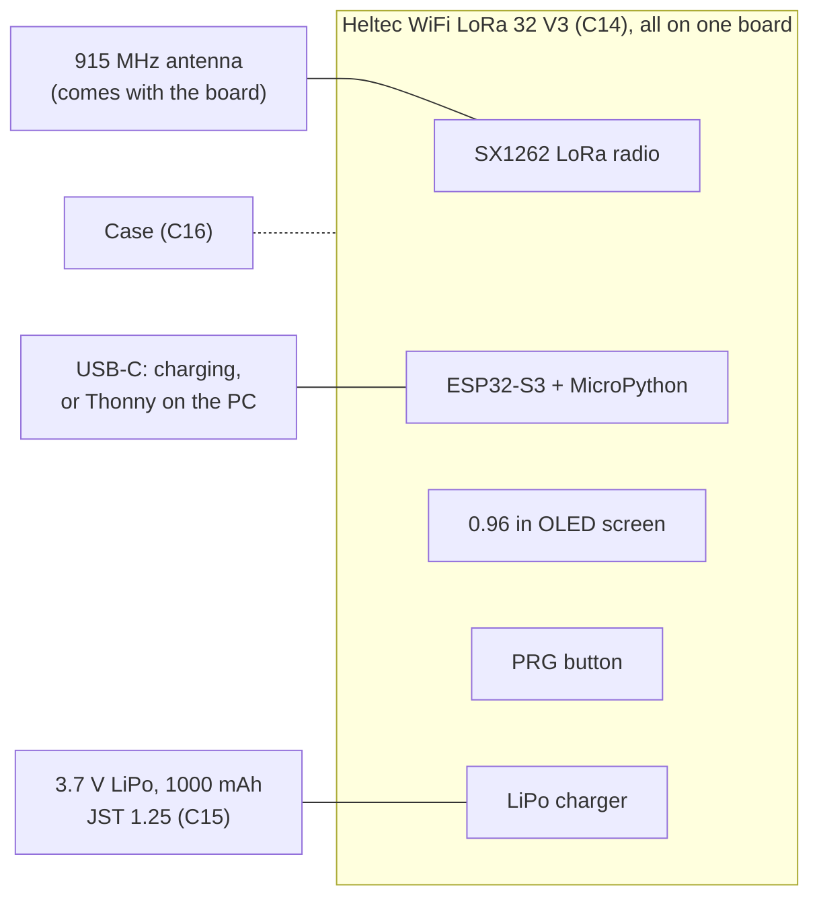
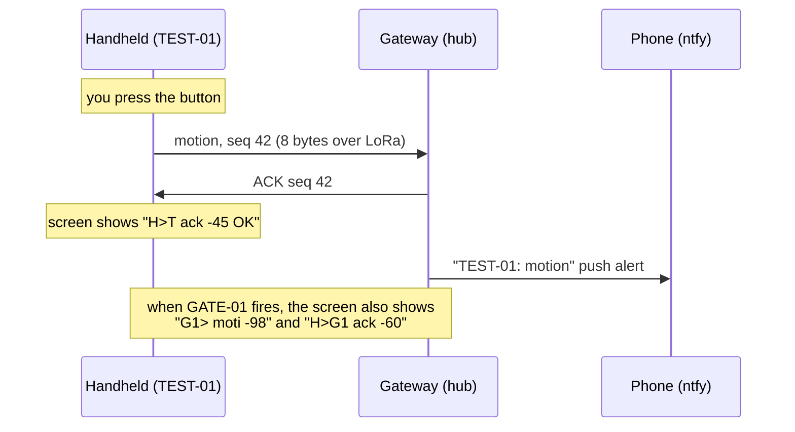

# Component design – Phase 1 (DIY)

This file tracks every Phase 1 build: which assemblies there are, the parts in each, how each part connects, which code drives it, how to test it, and its status. When a part arrives, passes its test or changes, update its row here. Purchasing details are in [shopping-list.md](shopping-list.md), and the reasoning behind each choice is in [design.md](design.md).

**Every node has exactly one radio.** The gateway and gate node are each a Pico plus a Waveshare Pico-LoRa-SX1262. The handheld test node is a Heltec V3, which has the same SX1262 radio chip built in.

## Assemblies

| Type | Assembly | Qty | Job | Firmware |
| --- | --- | --- | --- | --- |
| 1 | **Gateway** (tower hub) | 1 | Hears every node, ACKs, logs, pushes phone alerts over WiFi | `firmware/hub/` |
| 2 | **Gate PIR node** (GATE-01) | 1 | Detects a person, animal or vehicle at the gate and reports it | `firmware/gate/` |
| 3 | **Handheld test node** (TEST-01) | 1 | Pocket device with a screen. A button fakes a sensor hit, and the screen shows every packet it hears, including the gateway's replies. It doubles as the handheld for the range walk. | `firmware/tester/`, `firmware/tools/radio_test.py` |

These diagrams render on GitHub. In VS Code, install the "Markdown Preview Mermaid Support" extension.

### Type 1 – Gateway ×1

**Battery?** It isn't needed when the tower has mains or PoE. The Waveshare board has a LiPo port and charger, so a small LiPo (600–1000 mAh) can keep the hub alive for a few hours through a power cut. It only becomes required if the hub runs on solar (C9).

### Type 2 – Gate PIR node ×1

**Battery?** No. It runs from the gate's existing solar battery through the buck converter.

### Type 3 – Handheld test node ×1

**Battery?** Yes, a small LiPo makes it a true handheld, and it charges over USB-C.

### What the handheld lets you see

Radio is broadcast: every node in range hears every transmission, whoever it's addressed to. So the handheld sees the whole conversation:

## Parts per assembly (rollup)

| Part | Gateway ×1 | Gate node ×1 | Handheld ×1 | **Total** | Have | **Buy** |
| --- | --- | --- | --- | --- | --- | --- |
| Waveshare Pico-LoRa-SX1262 (868M/915M) | 1 | 1 | — | **2** | 0 | **2** |
| Heltec WiFi LoRa 32 V3, **915 MHz** | — | — | 1 | 1 | 0 | **1** |
| 3.7 V LiPo, about 1000 mAh, JST 1.25 | — | — | 1 | 1 | 0 | **1** |
| Heltec V3 case | — | — | 1 | 1 | 0 | **1** |
| Pico W | 1 | — | — | 1 | 1 (Kepler kit) | 0 |
| Pico H (or WH) | — | 1 | — | 1 | 0 | **1** |
| PIR module | — | 1 | — | 1 | 1 (Kepler kit) | 0 |
| QMC5883L magnetometer | — | 1 | — | 1 | 0 | **1** |
| Reed switch, outdoor (optional) | — | 1 | — | 1 | bench only (kit) | **1** |
| 915 MHz outdoor antenna + u.FL-to-SMA pigtail | 1 | 1 | — (stock) | 2 | 0 | **2** |
| Lightning arrestor + ground wire | 1 | — | — | 1 | 0 | **1** |
| IP65 box + glands + desiccant | 1 | 1 | — | 2 | 0 | **2** |
| 12→5 V buck (micro-USB) + inline fuse | — | 1 | — | 1 | 0 | **1** |
| Hub power (C9) | 1 | — | — | 1 | ? | open |
| LiPo 3.7 V (optional) | 0–1 | — | — | 0–1 | 0 | optional |
| Wood post 4×4 + clamps | — | 1 | — | 1 | 0 | **1** |
| USB data cable | micro-B | micro-B | USB-C | 3 | check | as needed |
| Breadboard + jumpers | bench | bench | — | — | yes (kit) | 0 |

## Parts detail

**Status values:** `owned` · `to order` · `ordered` · `received` · `bench tested` · `installed`

| ID | Part | Assembly | Interface / pins | Code | Bring-up test | Status |
| --- | --- | --- | --- | --- | --- | --- |
| C1 | Raspberry Pi Pico W | Gateway | Micro-USB 5 V | `firmware/hub/main.py` | Flash MicroPython, blink the LED from the REPL | owned |
| C2a | Waveshare Pico-LoRa-SX1262 (868M/915M) | Gateway, on C1 | SPI1, see the pin map | `firmware/lib/radio.py` | `tools/radio_test.py` as `pong` | to order |
| C2b | Waveshare Pico-LoRa-SX1262 (868M/915M) | Gate node, on C3 | SPI1, see the pin map | `firmware/lib/radio.py` | `tools/radio_test.py` as `ping`; RSSI and SNR at 207 m | to order |
| C3 | Raspberry Pi Pico H | Gate node | Micro-USB 5 V from C8 | `firmware/gate/main.py` | Flash MicroPython, blink the LED from the REPL | to order |
| C4 | PIR. Kepler kit module (HC-SR501 type, up to 7 m); AM312 as the low-power option | Gate node, aimed along the approach | GP16 in. Kit module: VCC to VBUS (5 V, pin 40), GND. AM312: 3V3, GND. | `gate/main.py` (`pir_confirmed`) | `tools/sensor_test.py`: `pir 1` when you walk past | owned (Kepler kit) |
| C5 | QMC5883L (GY-271) magnetometer | Gate node, beside the drive | I2C0: SDA GP4, SCL GP5, 3V3, GND | `lib/qmc5883l.py`, `gate/main.py` (`mag_confirmed`) | `tools/sensor_test.py`: `0xd` on scan, then set `MAG_THRESHOLD` by driving past | to order |
| C6 | Reed switch, N.O. (optional). Kit glass reed for the bench; outdoor-rated for the gate | Gate node: switch on the post, magnet on the gate | GP17 to GND, internal pull-up | `gate/main.py` (`gate_opened`) | `tools/sensor_test.py`: `gate open/shut`, then set `REED_PIN = 17` | bench: owned (Kepler kit); gate: to order |
| C7 | Battery sense (optional) | Gate node, on C2b | GP26 (Waveshare BAT_AD) | `gate/main.py` (`battery`) | `tools/sensor_test.py`: compare with a multimeter and fix `BATTERY_DIVIDER` | unused; on buck power |
| C8 | 12 V → 5 V buck converter, micro-USB, with a 1–2 A inline fuse | Gate node, from the gate's solar battery | 8–32 V in, 5 V micro-USB out | — | Multimeter reads 5.0 V before you plug in the Pico | to order |
| C9 | Hub power (USB supply, PoE splitter or solar) | Gateway | 5 V micro-USB | — | Hub stays up for 24 h | open: tower power |
| C10 | 915 MHz omni antennas + u.FL-to-SMA pigtails (×2) | Gateway (tower top); gate node (post, 6–8 ft) | u.FL on C2 | — | Compare `radio_test` RSSI with the stock antenna | to order |
| C11 | Lightning arrestor + ground wire | Gateway | SMA inline | — | Continuity to the tower ground | to order |
| C12 | IP65 enclosures, glands, desiccant (×2) | Gateway, gate node | — | — | No condensation after a week | to order |
| C13 | ntfy phone app and topic | Gateway output | HTTPS from C1 over the house WiFi | `hub/main.py` (`push`), `secrets.py` | "Hub online" alert at hub boot | to set up |
| C14 | Heltec WiFi LoRa 32 V3, 915 MHz (ESP32-S3 + SX1262 + OLED) | Handheld | Built in. Pins are in `lib/board.py` (esp32 profile). | `firmware/tester/main.py`, `lib/screen.py` | `tools/radio_test.py` shows `radio ok` on its screen | to order |
| C15 | 3.7 V LiPo, about 1000 mAh, JST 1.25 2-pin. **Check polarity** against the Heltec's battery socket before plugging in. | Handheld | Battery socket on the back | — | Unplug USB: it keeps running | to order |
| C16 | Heltec V3 case | Handheld | — | — | Button and screen reachable | to order |

## Pin maps

**Gate node (C3 + C2b)**

| GPIO | Used by |
| --- | --- |
| GP2 | LoRa BUSY (C2b) |
| GP3 | LoRa CS (C2b) |
| GP4 / GP5 | I2C0 SDA / SCL, magnetometer (C5) |
| GP10 / GP11 / GP12 | LoRa SPI1 SCK / MOSI / MISO (C2b) |
| GP15 | LoRa RESET (C2b) |
| GP16 | PIR out (C4) |
| GP17 | Reed switch (C6), optional |
| GP20 | LoRa DIO1 (C2b) |
| GP26 | Battery ADC (C7), optional |

**Gateway (C1 + C2a):** the LoRa pins are the same as the gate node's. No other GPIO is used. WiFi runs on the Pico W's internal pins and doesn't conflict.

**Handheld (C14):** everything is on the board. The radio, OLED, LED and PRG button pins are in `lib/board.py`.

## Bring-up order

The gateway build is covered step by step in [hub-build-guide.md](hub-build-guide.md). The Phase 1 gateway is DIY on the Pico W, running the MicroPython firmware.

1. **Radios on the bench (C1, C2a, C14):** run `radio_test.py`, the gateway as `pong` and the handheld as `ping`. If init fails, see `TCXO_MV` in `lib/radio.py`.
2. **Gateway firmware + handheld:** run `hub/main.py` on the gateway and `tester/main.py` on the handheld. A PRG press should show the ACK on its screen and send a "TEST-01: motion" alert to your phone.
3. **Gate sensors on the bench (C3, C4–C6):** run `sensor_test.py` on the gate board, then `gate/main.py`. Leave the handheld listening to watch GATE-01 and the gateway talk.
4. **Range at the site (C10):** with the gateway on the tower, walk the handheld (running `radio_test.py` as `ping`) to the gate post, log RSSI and SNR. Aim for SNR above 0 dB and 9/10 or more replies.
5. **Install (C8, C11, C12):** mount the gate node on the post, tune `MAG_THRESHOLD` with real vehicles, then watch heartbeats for a week.

## Open items

- C9 tower power: mains, PoE or solar.
- C6: check whether the gate controller already has a dry-contact gate-open output.
